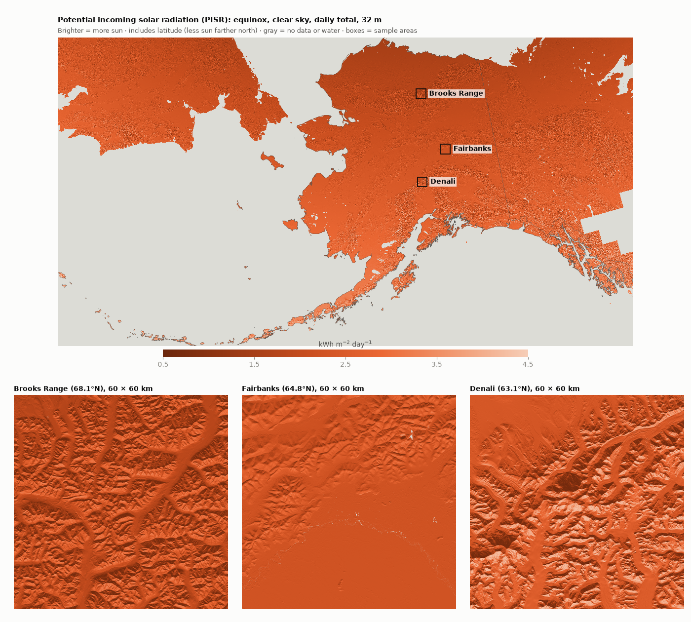
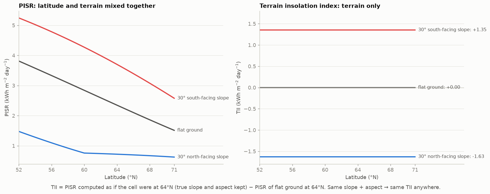
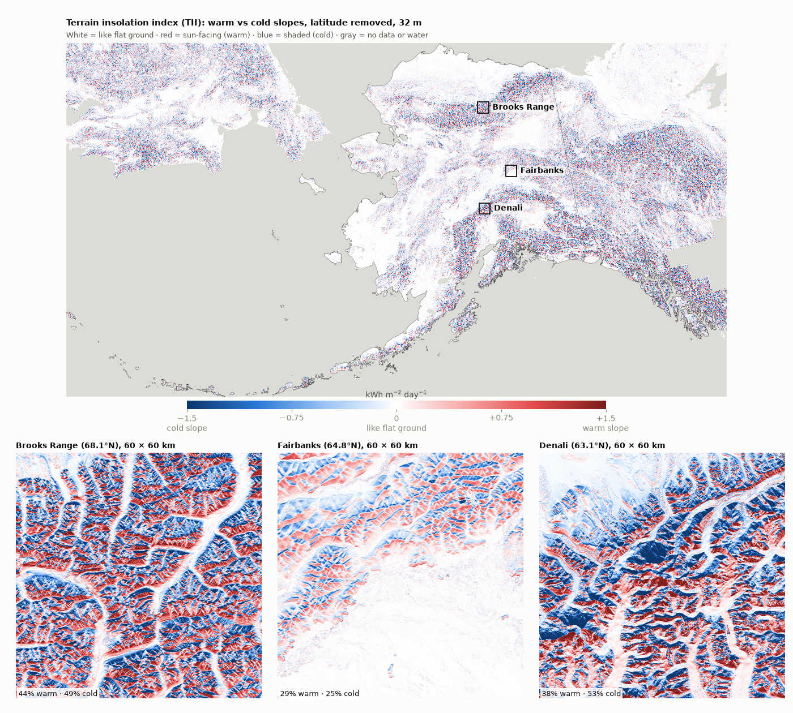
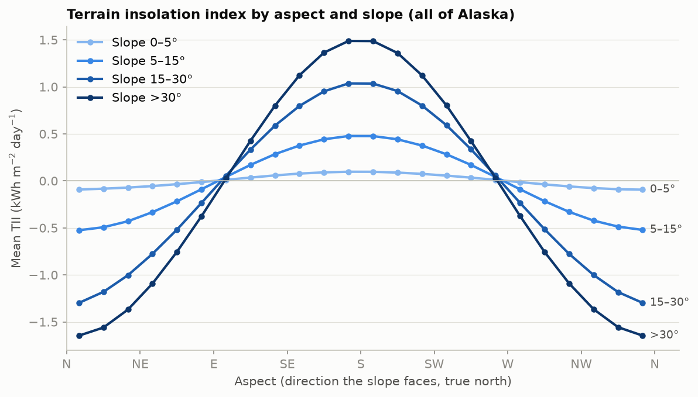
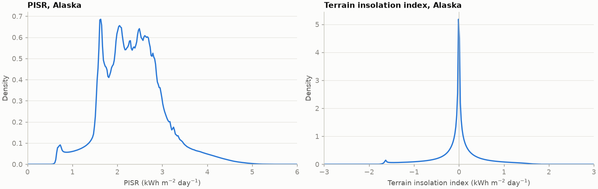
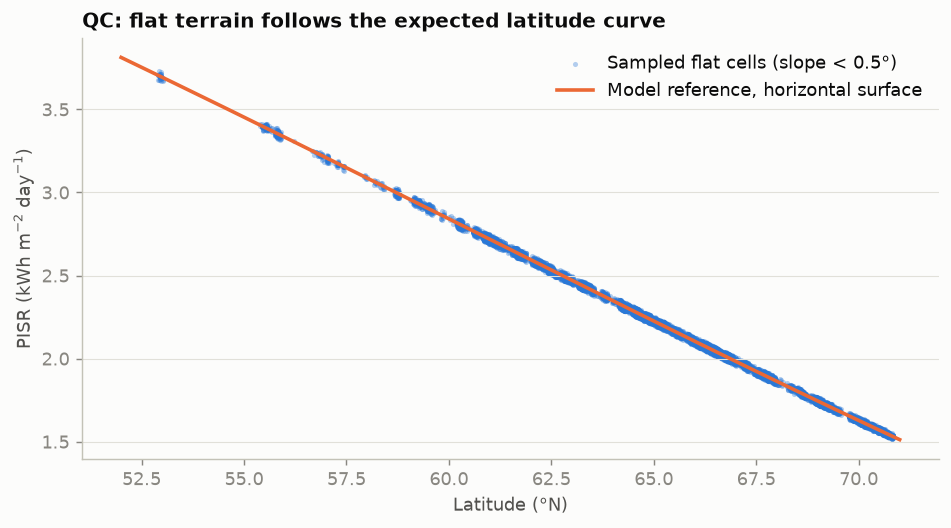

# Equinox solar radiation and terrain insolation index for Alaska (32 m)

Two new statewide layers built from ArcticDEM. Both describe how much sun the terrain receives on an equinox
day. The **terrain insolation index** is the one to use as a slope/aspect variable: one number per pixel saying
how much warmer or colder a slope is than flat ground.

| | |
|---|---|
| **File** | `/beegfs/CMIP6/jdpaul3/ArcticDEM-PISR_data/output/arcticdem_v4.1_pisr_equinox_32m_3338.nc` (27 GB) |
| **Variables** | `terrain_insolation_index` (TII), `pisr`, `elevation`. All float32, kWh m⁻² day⁻¹ (elevation in m) |
| **Grid** | EPSG:3338 (Alaska Albers), 32 m, 114,411 × 61,391 cells, Alaska's bounding box |
| **Source** | ArcticDEM mosaic v4.1, 32 m (Polar Geospatial Center) |
| **NoData** | Water (lakes, sea) and areas without ArcticDEM coverage |

## 1. Potential incoming solar radiation (PISR)

PISR is the clear-sky solar energy reaching each 32 m cell over one equinox day, given its slope, the direction it
faces, and its latitude. At the equinox the noon sun is only 19–39° above the horizon in Alaska, so terrain
matters a lot: a steep south face can get 5× the energy of a steep north face nearby.

PISR mixes two signals: **latitude** (everything gets less sun farther north, which is the smooth gradient in the
map) and **terrain** (the speckle of sunny and shaded slopes). The other variables in our composite index (air
temperature, ground temperature, permafrost probability) already carry the latitude signal, so we separate the two.

## 2. Terrain insolation index (TII): terrain only

**What it does.** For every cell we keep its real slope and the direction it faces, but compute its equinox sunshine
*as if it were at 64°N* (central Alaska), then subtract what flat ground at 64°N would get.

- **0** = gets the same sun as flat ground. **Positive** = warm, sun-facing slope. **Negative** = cold, shaded slope.
- The **same slope and aspect give the same value anywhere** in Alaska (left panel above: PISR drifts with
  latitude; right panel: TII doesn't).
- Elevation and latitude are not in it, so it doesn't double-count what temperature and permafrost layers already know.

Flat lowlands are white everywhere, from the North Slope to the Kenai, and the Tanana Flats south of Fairbanks.
Mountains show warm and cold slopes side by side at every latitude: the Brooks Range (68°N) and Denali (63°N) look
alike, as they should, and slopes there are 44% / 38% warm and 49% / 53% cold. Around Fairbanks, nearly half
of the area (46%) is close to flat (white).

Steeper slopes push TII further from zero. South faces are warmest, north faces coldest, and east and west faces
stay close to zero. North faces lose more than south faces gain: at 64°N, a north face steeper than the noon sun
(26°) gets no direct sun at all, only sky light, so the coldest slopes bottom out near −1.6 (the small bump in the
distribution below). The same effect bends the north-slope curve in the latitude figure above at 60°N.

## 3. How it was made

| Step | Choice |
|---|---|
| DEM | ArcticDEM v4.1, 494 tiles at 32 m, mosaicked and warped to 32 m EPSG:3338 |
| Gaps | 6,398 small DEM holes (≤ 1 km² each, 294 km² total) filled by interpolation |
| Water | ArcticDEM flattens lakes and sea; those cells (flagged no-data and flat) are set to NoData |
| Sun | Idealized equinox (sun over the equator), clear sky, direct + diffuse light, 5-minute steps over the day |
| Shading | Each slope shades itself; shadows cast by distant mountains are not included |
| Geometry | Slopes converted to true north at every cell (map projections rotate and stretch "north" by up to 30°) |

Code and full method: [README](../README.md), model in [`solar.py`](../src/arcticdem_pisr/solar.py).

## 4. Quality checks

| Check | Result |
|---|---|
| Model vs an independent solar library (pvlib), 84 slope/aspect/site cases | max difference 0.003% |
| Same terrain computed in two map projections (Denali) | bias 0.01%, r = 0.9993 |
| Flat ground vs the theoretical value for its latitude (sampled flat cells, figure below) | mean difference −0.05% |
| TII of flat ground (should be 0) | mean −0.001 |
| Correlation with latitude | PISR −0.63, **TII 0.01** |
| Mean TII of 15–30° south faces, south of 60°N / 60–66°N / north of 66°N | +1.05 / +1.01 / +1.02 (PISR: 4.25 / 3.46 / 2.82) |
| Mean TII of 15–30° north faces, same bands | −1.29 / −1.26 / −1.28 (PISR: 1.59 / 1.15 / 0.84) |
| NoData pattern, physical range, recomputation, tile and processing seams | all pass (11 of 11 automated checks) |
| Alaska with a value | 98.7% (the rest is lakes, now NoData, and a few DEM gaps) |

## 5. Using it in the composite index

- **Sign:** positive TII = warm slope = *less* likely permafrost. Flip the sign if your index runs the other way.
- **Scaling to 0–1:** TII is centered on 0 (Alaska median 0.00, 1st–99th percentile −1.58 to +1.36). Clip at
  ±1.6 (99th percentile of |TII|) and map linearly so that **0.5 = flat ground**, 0 = coldest, 1 = warmest. On a
  0–100 integer scale, 50 = flat and each step is 0.032 kWh m⁻² day⁻¹.
- **Check for overlap:** if the permafrost probability layer already used aspect or solar radiation as a predictor,
  some of the terrain signal is shared. Consider a lower weight.
- **Limits:** clear-sky potential only (no clouds or snow), and no shadows from neighboring mountains. Interpolated
  DEM holes are smooth, so they read as flat (under 0.01% of cells). Parts of Yukon, BC, and Chukotka are included.

---
*Source data:* Porter, C., et al., 2023, "ArcticDEM – Mosaics, Version 4.1", https://doi.org/10.7910/DVN/3VDC4W,
Harvard Dataverse, V1. DEMs provided by the Polar Geospatial Center under NSF-OPP awards 1043681, 1559691,
1542736, 1810976, and 2129685.
